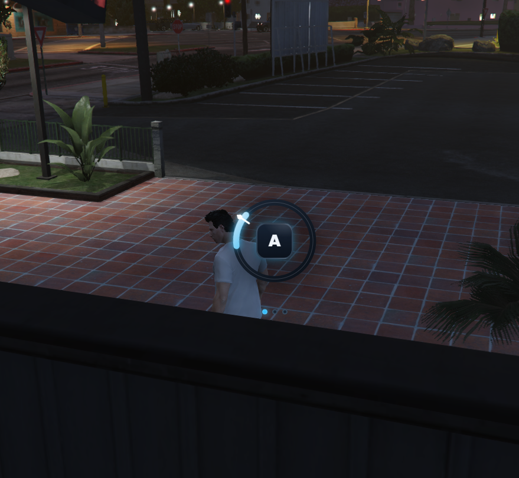
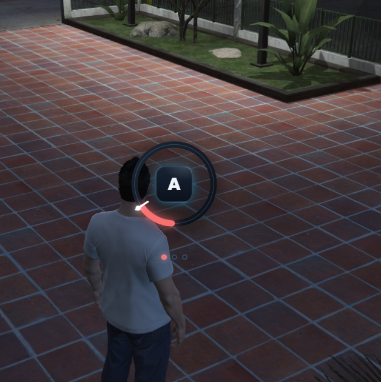
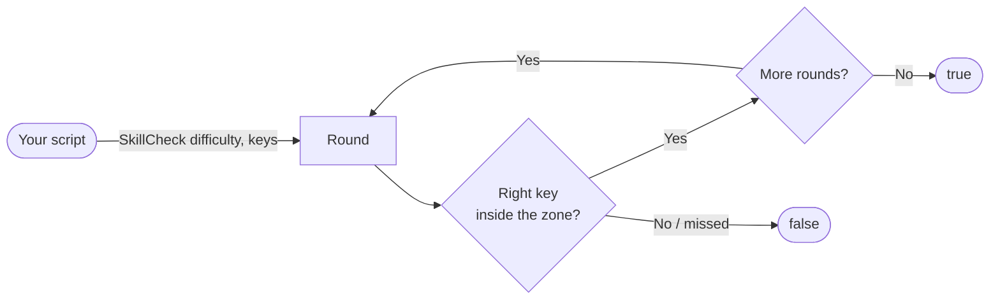

<div align="center">



<br>


**Skill check minigame in JVL Steel Blue with the same API as ox_lib's `lib.skillCheck`.**
Switching any script to it is a one-line change.

[Features](#-features) · [How it works](#-how-it-works) · [Installation](#-installation) · [API](#-api) · [License](#-license)

</div>

---

## ✨ Features

<table>
<tr>
<td width="50%" valign="top">

### 🎯 Drop-in for lib.skillCheck
Same arguments and the same `true` / `false` result: difficulties `easy`, `medium`, `hard` or custom `{ areaSize, speedMultiplier }`, and a list of keys.

### 🔁 Several rounds
Pass a list of difficulties and each one is a round, with dots that show the progress.

</td>
<td width="50%" valign="top">

### ⌨️ Random keys
One key per round is picked at random from the list you pass (`Config.DefaultKeys` when none).

### ⚙️ Configurable
Difficulty presets, base turn time, position (`center` / `bottom`), success / fail sounds and a test command, all in `config.lua`. Standalone: no framework needed.

</td>
</tr>
</table>

## 📸 Preview

<div align="center">
<table>
<tr>
<td align="center"><br><sub>Round in progress: press the key inside the zone</sub></td>
<td align="center"><br><sub>Missed: the wheel turns red and the check fails</sub></td>
</tr>
</table>
</div>

## 🔄 How it works



Keys outside the allowed list are ignored; a wrong allowed key, a press outside the zone or letting the zone pass fails the check. NUI focus is only taken while a check runs and is always released.

<details>
<summary><b>📁 Project structure</b></summary>

<br>

| Path | Contents |
| --- | --- |
| `fxmanifest.lua` | Resource manifest (no dependencies) |
| `config.lua` | Default keys, difficulties, turn time, position, sounds, test command |
| `client.lua` | `SkillCheck`, `Cancel` and `IsActive` exports, NUI focus and callbacks |
| `web/` | NUI (`index.html`, `style.css`, `script.js`, `jvl-steel-blue.css`) |
| `assets/readme/` | README banner (not loaded in game) |

</details>

## 🚀 Installation

1. Download this repository into your `resources` folder as `jvl_skillcheck`.
2. Add it to `server.cfg`:

```cfg
ensure jvl_skillcheck
```

3. Test it in game: `/testskill [easy|medium|hard] [rounds]` (change or disable it with `Config.TestCommand`).

## 🧩 API

```lua
-- Same as lib.skillCheck
local success = exports.jvl_skillcheck:SkillCheck({ 'easy', 'easy', 'medium' }, { 'w', 'a', 's', 'd' })

-- Custom difficulty
local success = exports.jvl_skillcheck:SkillCheck({ areaSize = 30, speedMultiplier = 1.6 })

exports.jvl_skillcheck:Cancel()            -- stops the running check (it returns false)
local running = exports.jvl_skillcheck:IsActive()
```

Fallback to ox_lib when the resource is not started:

```lua
function SkillCheck(difficulty, keys)
    if GetResourceState('jvl_skillcheck') == 'started' then
        return exports.jvl_skillcheck:SkillCheck(difficulty, keys) == true
    end
    return lib.skillCheck(difficulty, keys) == true
end
```

```lua
-- config.lua
Config.DefaultKeys = { 'e' }
Config.Difficulties = {
    easy = { areaSize = 50, speedMultiplier = 1.0 },
    medium = { areaSize = 40, speedMultiplier = 1.5 },
    hard = { areaSize = 25, speedMultiplier = 1.75 },
}
Config.BaseTurnTime = 2000   -- ms per full turn at speedMultiplier 1.0
Config.Position = 'center'   -- 'center' | 'bottom'
Config.Sounds = true
Config.TestCommand = 'testskill' -- false = disabled
```

---

## 📄 License

Released under the **MIT License** — free to use, modify and share, keeping the copyright notice. See [`LICENSE`](LICENSE).

© 2026 JVL MediaCode

---

<div align="center">

Made by **[JVL MediaCode](https://jvlmediacode.com)** · Jose M. Valenzuela · Meoqui, Chihuahua, México

<sub><a href="mailto:contacto@jvlmediacode.com">contacto@jvlmediacode.com</a> · <a href="https://discord.gg/m2spgxkPfj">Discord</a></sub>

</div>
